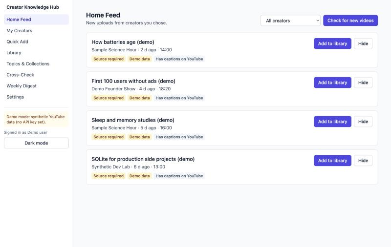
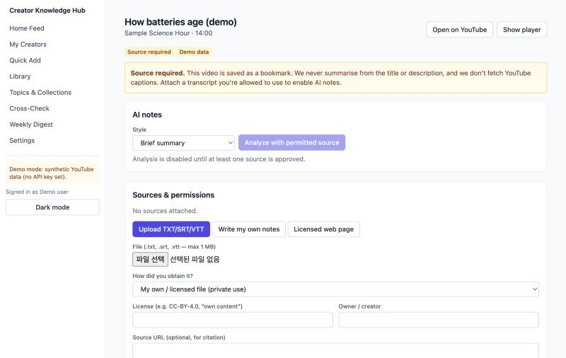
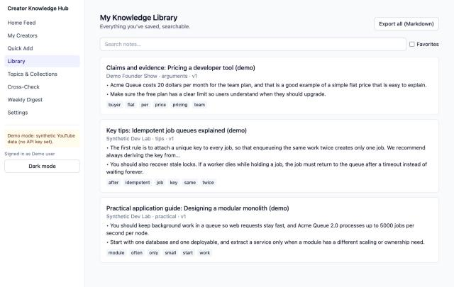
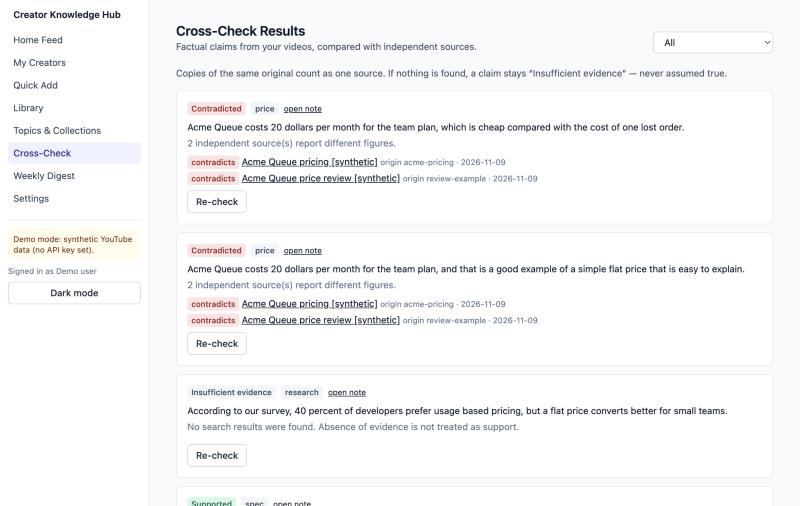
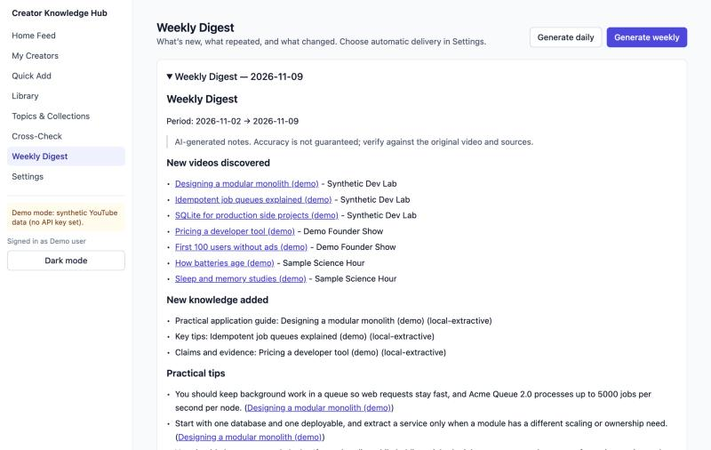
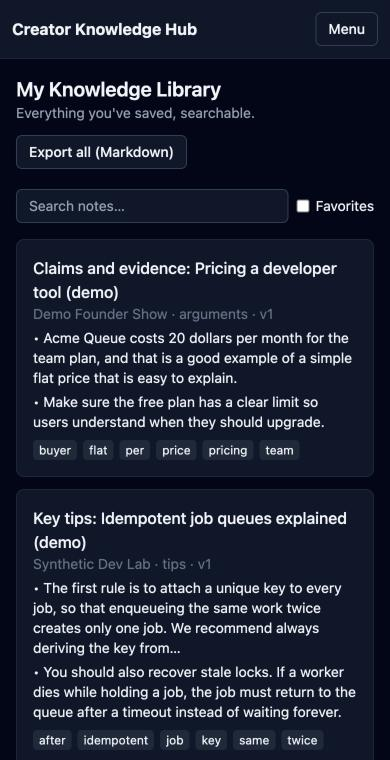

[English](README.md) · **한국어**

# Creator Knowledge Hub

**내가 고른** YouTube 크리에이터를 위한, 비공개이며 권한을 존중하는 지식 라이브러리입니다. 크리에이터를 팔로우하고, 새 업로드를 피드로 받고, 사용이 허용된 자막을 첨부하고, 독립적인 AI 노트를 받고, 나중에 검색하고, 사실 주장을 교차 검증하고, 여러 영상을 하나의 브리핑으로 합치고, 다이제스트를 받을 수 있습니다.

> **상태: 동작하는 MVP / 포트폴리오 데모.** *데모 모드*(가상 YouTube 데이터 + 로컬 비LLM 요약기)에서 완전히 오프라인으로 실행됩니다. 실제 YouTube 데이터와 LLM은 환경 변수로 직접 켜야 합니다. [구현된 것과 제한된 것](#구현-vs-제한)을 참고하세요.

| 홈 피드 | 출처 필요 (가짜 요약 없음) |
|---|---|
|  |  |
| **라이브러리** | **근거 기반 교차 검증** |
|  |  |
| **주간 다이제스트** | **모바일 + 다크 모드** |
|  |  |

*스크린샷은 가상 데모 데이터만 보여줍니다. 앱 UI는 영어이므로 두 언어 버전이 같은 캡처를 사용합니다.*

## 문제의식
많은 크리에이터를 팔로우하면 업로드를 놓치고 배운 것을 잊게 됩니다. 일반적인 "YouTube 요약기"는 자막을 긁어오거나 제목만 보고 요약하는 경우가 많아 법적으로 위험하고 신뢰할 수 없습니다. 이 프로젝트는 **콘텐츠 권리를 코드로 강제되는 핵심 개념**으로 다룹니다. 허가가 기록된 출처가 없으면 아무것도 분석하지 않으며, 출처가 없는 영상은 솔직하게 *출처 필요*로 표시합니다.

## 기능
- **크리에이터:** URL/@핸들/ID/검색으로 팔로우, 즐겨찾기, 채널별 주제와 자동 발견 토글, 영상 숨기기, 중복 방지, 쿼터 가드가 있는 예약 폴링.
- **빠른 추가:** URL 붙여넣기 → 검증, 메타데이터 저장, 분석이 불가능해도 북마크 유지.
- **권한 정책이 있는 출처 커넥터:** TXT/SRT/VTT 업로드, 내 노트, 크리에이터 제공, 라이선스 배포본, SSRF 방어된 라이선스 웹페이지. 출처별 라이선스·소유자·범위·보관·인용·타임스탬프. 금지·미검증 경로는 강제로 비활성화됩니다.
- **개인화 노트:** 8가지 스타일, 역할과 관심사에 따라 강조점 변경, 모든 항목에 *출처*(구간 인용 + 타임스탬프 링크) 또는 *AI 추가* 태그, 편집·주석·재생성(수정 이력)·Markdown 내보내기.
- **라이브러리:** FTS5 전문 검색, 태그/주제, 컬렉션, 즐겨찾기, 관련 노트, 중복 탐지, 지식 이력.
- **교차 검증:** 주장 추출 → 검색 어댑터 → URL/제목/날짜가 있는 근거 → 판정(*지지됨 / 부분 지지 / 반박됨 / 근거 부족 / 오래됨*). 같은 원본의 사본은 한 번만 셉니다. 결과 없음 ≠ 사실.
- **종합:** 공통 vs 크리에이터별 vs 새로운 vs 상충하는 요점을 중복 제거하여, 각각 출처 영상에 연결합니다.
- **주간/일간 다이제스트**(옵트인), 공식 API 필터를 쓰는 **발견**(통계 필터는 정책 검토 전까지 비활성), 명시한 관심사만 쓰는 **콘텐츠 기반 추천**.
- **크리에이터 옵트인** 구조와 **삭제 요청·내 데이터 삭제** 흐름(결제 없음).
- **UI:** 9개 화면, 반응형, 라이트/다크, 키보드/ARIA 기본, 로딩·빈 상태·오류·권한 상태.

## 아키텍처
```mermaid
flowchart LR
  UI[React SPA] -->|REST| API[FastAPI]
  API --> POL{Source permission policy}
  POL -- approved --> AN[Analysis] --> LLM[LLM provider: local | anthropic]
  POL -- not approved --> BLOCK[Source required / blocked]
  API --> YT[YouTube Data API v3 only]
  API --> SRCH[Search: fixture | brave]
  JOBS[Job queue + scheduler] --> YT
  API --> DB[(SQLite → Postgres)]
```
상세 설명과 트레이드오프: [docs/ARCHITECTURE.md](docs/ARCHITECTURE.md).

## 기술 스택
React 18 · TypeScript · Vite · Tailwind CSS · FastAPI · Pydantic 2 · SQLAlchemy 2 · SQLite (FTS5) · httpx · pytest · Vitest · GitHub Actions.

## 빠른 시작
Python 3.11+와 Node 20+가 필요합니다.
```bash
# 백엔드
cd backend && python3 -m venv .venv && .venv/bin/pip install -r requirements.txt
cd ../frontend && npm install && npm run build      # FastAPI가 frontend/dist를 서빙
cd ../backend && .venv/bin/uvicorn app.main:app --port 8000
# http://127.0.0.1:8000 을 열고 (프로필 생성, @syntheticdevlab 등 팔로우)
```
선택 사항인 데모 데이터(가상 전용): `backend/.venv/bin/python scripts/seed_demo.py`를 실행한 뒤, 브라우저 콘솔에서 `localStorage.setItem("ckh-token","<출력된 토큰>")`.
핫 리로드 프런트엔드 개발 서버: `cd frontend && npm run dev` (`/api`를 :8000으로 프록시).

## 설정
`.env.example` → `.env`로 복사하세요(git 제외). 모두 선택 사항입니다.

| 변수 | 용도 |
|---|---|
| `CKH_YOUTUBE_API_KEY` | 공식 YouTube Data API v3 키. 미설정 시 가상 채널의 데모 모드 |
| `CKH_YOUTUBE_DAILY_QUOTA`, `CKH_YOUTUBE_SEARCH_DAILY_LIMIT` | 로컬 쿼터 가드 |
| `CKH_LLM_PROVIDER` (`local`/`anthropic`), `CKH_ANTHROPIC_API_KEY`, `CKH_ANTHROPIC_MODEL`, `CKH_LLM_DAILY_CALL_LIMIT` | 요약기. 외부 사용은 사용자별 동의 필요 |
| `CKH_SEARCH_PROVIDER` (`fixture`/`brave`), `CKH_BRAVE_API_KEY` | 교차 검증 검색 |
| `CKH_DATABASE_URL` | 기본은 SQLite, 프로덕션은 Postgres URL |
| `CKH_ENABLE_SCHEDULER=true` | 15분마다 백그라운드 폴링/다이제스트 |
| `CKH_ALLOW_SIGNUP`, `CKH_ENABLE_STAT_FILTERS` | 접근·정책 스위치 |

**비용 구조:** YouTube Data API는 쿼터 내에서 무료입니다(목록 호출 1유닛, `search.list`는 기본적으로 별도의 하루 100회 버킷). 로컬 요약기와 fixture 검색은 무료입니다. Anthropic과 Brave는 호출당 과금되는 유료 서비스이므로 최신 요금을 확인하세요. 예산은 `CKH_LLM_DAILY_CALL_LIMIT`으로 제한됩니다.

## 테스트
```bash
cd backend && .venv/bin/python -m pytest -q          # 74개 테스트
cd frontend && npm test && npm run typecheck && npm run build
python3 scripts/secret_scan.py
```
백엔드 테스트는 정책/권리 강제, SSRF, 업로드, 인젝션, 마스킹, 작업(멱등성/재시도/오래된 락), YouTube 어댑터(mock transport), LLM 어댑터(mock transport), 주장 평가, 사용자별 격리, 삭제, 삭제 요청, 속도 제한, 그리고 **HTTP API를 통한 인수 시나리오 A–F 종단 간 테스트**(`tests/test_scenarios.py`)를 다룹니다.
**Fixture vs 실제 AI:** 테스트는 가상 데모 채널, 직접 작성한 자막(`samples/`), 가상 검색 코퍼스, *로컬 추출식* 요약기를 사용합니다. 실제 LLM이나 실제 YouTube/검색 서비스는 **실행하지 않으며**, 해당 어댑터는 mock HTTP로만 테스트됩니다.

## 구현 vs 제한
| 영역 | 상태 |
|---|---|
| 위의 모든 기능 | 데모/가상 데이터 기준으로 구현 및 테스트됨 |
| 실제 YouTube API | 문서화된 엔드포인트에 맞춰 구현. mock transport로만 검증(이 환경에는 키 없음) |
| 실제 LLM 요약 | Anthropic 어댑터 구현, mock transport로만 검증. 기본 요약기는 **LLM이 아닌 휴리스틱 추출 도구** |
| 실제 웹 교차 검증 | Brave 어댑터 구현, mock만 검증. 판정은 투명한 휴리스틱 판정기에서 나옴 |
| 브라우저 E2E | 시드된 서버에 대한 UI 수동 점검(위 스크린샷). **자동화된 브라우저 테스트는 아직 없음** |
| 크리에이터 OAuth / 소유권 검증, 제3자 자막 제공자 | 설계상 비활성 |
| 시맨틱 검색, Notion API 동기화, 결제/수익 배분 | 미구현 |
| 프로덕션 하드닝 | CSP, 공유 속도 제한 저장소, 의존성 스캔 아직 없음 ([docs/PRIVACY_SECURITY.md](docs/PRIVACY_SECURITY.md)) |

## 법적·규정 준수 한계
[LEGAL_COMPLIANCE](docs/LEGAL_COMPLIANCE.md), [CONTENT_RIGHTS](docs/CONTENT_RIGHTS.md), [YOUTUBE_API_POLICY](docs/YOUTUBE_API_POLICY.md), [PRIVACY_SECURITY](docs/PRIVACY_SECURITY.md)를 읽어 주세요. 요약하면: 스크래핑 없음, 자막 다운로드 없음, 다운로드 후 STT 없음, 제3자 자막 제공자 없음. 자막은 허용된 출처에서만 사용하며, 사용자 확인은 기록되지만 검증은 아닙니다. 이 소프트웨어는 법적 준수를 보장하지 않으며 법률 자문이 아닙니다.

## 로드맵
1. YouTube/LLM/검색 어댑터의 실제 키 검증과 Playwright E2E 스위트.
2. 크리에이터 OAuth + 소유권 검증, 검증된 크리에이터 제공 자막.
3. Postgres FTS + 시맨틱 검색, 공유 속도 제한, CSP, 의존성 스캔.
4. Notion 내보내기/동기화, 더 풍부한 다이제스트, 요청자 검증이 있는 삭제 요청 워크플로.
5. 비공개 상용 계층(결제, 크리에이터 수익 배분)은 이 공개 저장소 밖에 둡니다.

## 라이선스
라이선스를 의도적으로 정하기 전까지 코드는 **모든 권리 보유**입니다. 평가를 위한 열람은 환영하며, 재사용에는 허가가 필요합니다. 참고: 코드 라이선스는 제3자 영상이나 자막에 대한 어떤 권리도 부여하지 않습니다. `samples/`는 직접 작성한 가상 텍스트입니다.
