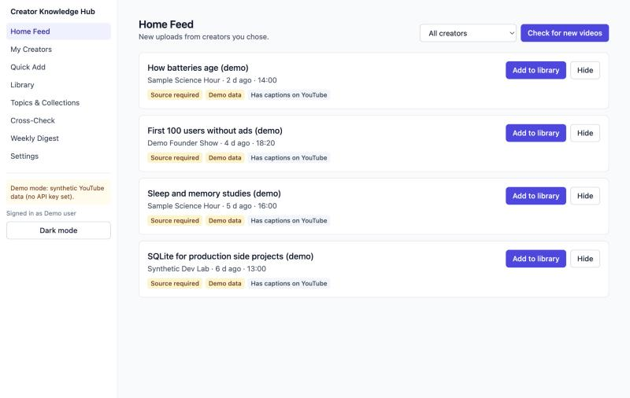
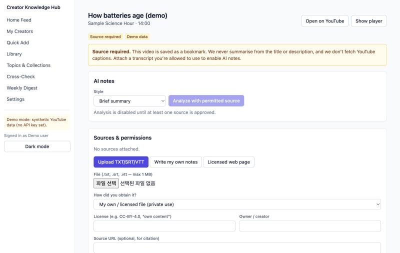
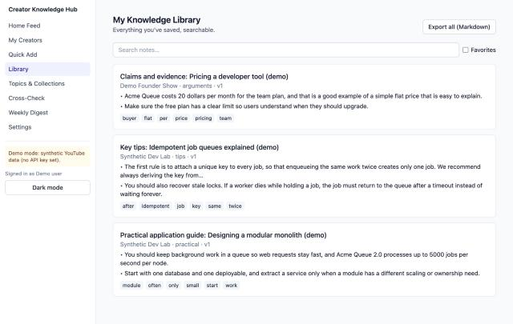
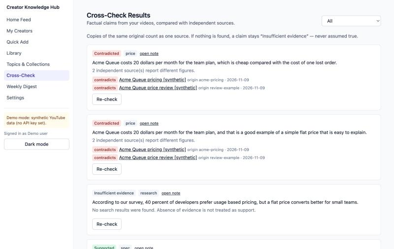
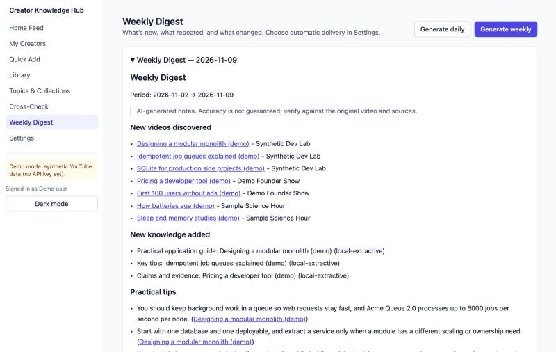
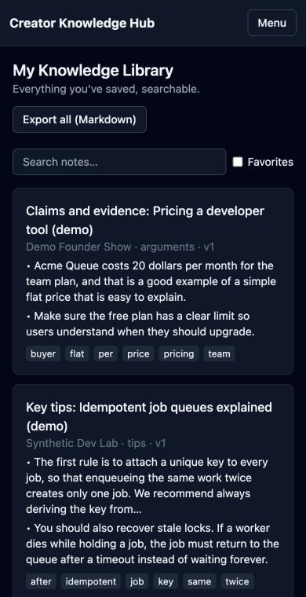

# Creator Knowledge Hub

A private, permission-aware knowledge library for the YouTube creators **you** choose. Follow creators, get new uploads in a feed, attach a transcript you are allowed to use, get independent AI notes, search them later, cross-check factual claims, merge several videos into one briefing, and receive a digest.

> **Status: working MVP / portfolio demo.** Runs fully offline in *demo mode* (synthetic YouTube data + a local, non-LLM summarizer). Real YouTube data and an LLM are opt-in via environment variables. See [what is and isn't implemented](#implemented-vs-limited).

| Home feed | Source required (no fake summaries) |
|---|---|
|  |  |
| **Library** | **Cross-check with evidence** |
|  |  |
| **Weekly digest** | **Mobile + dark mode** |
|  |  |

*Screenshots show synthetic demo data only.*

## The problem
Following many creators means missing uploads and forgetting what you learned. Generic "YouTube summarizers" also tend to scrape captions or summarize from titles alone, which is legally risky and unreliable. This project makes **content rights a first-class, code-enforced concept**: nothing is analysed unless a source with a recorded permission exists, and a video without one is honestly marked *Source required*.

## Features
- **Creators:** follow by URL/@handle/ID/search, favorites, per-channel topics and auto-discover toggle, hide videos, no duplicates, scheduled polling with quota guard.
- **Quick Add:** paste a URL → validated, metadata saved, bookmark kept even if analysis is impossible.
- **Source connectors with permission policy:** TXT/SRT/VTT upload, your own notes, creator-provided, licensed distributions, SSRF-guarded licensed web pages. Per-source license, owner, scope, retention, citation, timestamps. Prohibited/unverified paths are hard-disabled.
- **Personalised notes:** 8 styles; role and interests change emphasis; every point tagged *source* (with segment citation + timestamp link) or *AI-added*; edit, annotate, regenerate (revision history), Markdown export.
- **Library:** FTS5 full-text search, tags/topics, collections, favorites, related notes, duplicate detection, knowledge history.
- **Cross-check:** claim extraction → search adapter → evidence with URL/title/date → verdict (*Supported / Partially / Contradicted / Insufficient / Outdated*). Copies of the same origin count once; no results ≠ true.
- **Synthesis:** common vs creator-specific vs new vs conflicting points, deduplicated, each linked to its source video.
- **Weekly/daily digest** (opt-in), **discovery** with official-API filters (stat filters disabled pending policy review), **content-based recommendations** from explicit interests only.
- **Creator opt-in** structure and **takedown/delete-my-data** flows (no payments).
- **UI:** 9 screens, responsive, light/dark, keyboard/ARIA basics, loading/empty/error/permission states.

## Architecture
```mermaid
flowchart LR
  UI[React SPA] -->|REST| API[FastAPI]
  API --> POL{Source permission policy}
  POL -- approved --> AN[Analysis] --> LLM[LLM provider: local | anthropic]
  POL -- not approved --> BLOCK[Source required / blocked]
  API --> YT[YouTube Data API v3 only]
  API --> SRCH[Search: fixture | brave]
  JOBS[Job queue + scheduler] --> YT
  API --> DB[(SQLite → Postgres)]
```
Details and trade-offs: [docs/ARCHITECTURE.md](docs/ARCHITECTURE.md).

## Tech stack
React 18 · TypeScript · Vite · Tailwind CSS · FastAPI · Pydantic 2 · SQLAlchemy 2 · SQLite (FTS5) · httpx · pytest · Vitest · GitHub Actions.

## Quick start
Requires Python 3.11+ and Node 20+.
```bash
# backend
cd backend && python3 -m venv .venv && .venv/bin/pip install -r requirements.txt
cd ../frontend && npm install && npm run build      # FastAPI serves frontend/dist
cd ../backend && .venv/bin/uvicorn app.main:app --port 8000
# open http://127.0.0.1:8000  (create a profile, follow @syntheticdevlab etc.)
```
Optional demo data (synthetic only): `backend/.venv/bin/python scripts/seed_demo.py`, then in the browser console `localStorage.setItem("ckh-token","<printed token>")`.
Frontend dev server with hot reload: `cd frontend && npm run dev` (proxies `/api` to :8000).

## Configuration
Copy `.env.example` → `.env` (git-ignored). Everything is optional.

| Variable | Purpose |
|---|---|
| `CKH_YOUTUBE_API_KEY` | Official YouTube Data API v3 key; unset = demo mode with synthetic channels |
| `CKH_YOUTUBE_DAILY_QUOTA`, `CKH_YOUTUBE_SEARCH_DAILY_LIMIT` | local quota guards |
| `CKH_LLM_PROVIDER` (`local`/`anthropic`), `CKH_ANTHROPIC_API_KEY`, `CKH_ANTHROPIC_MODEL`, `CKH_LLM_DAILY_CALL_LIMIT` | summarizer; external use needs per-user consent |
| `CKH_SEARCH_PROVIDER` (`fixture`/`brave`), `CKH_BRAVE_API_KEY` | cross-check search |
| `CKH_DATABASE_URL` | SQLite by default; Postgres URL for production |
| `CKH_ENABLE_SCHEDULER=true` | background polling/digests every 15 min |
| `CKH_ALLOW_SIGNUP`, `CKH_ENABLE_STAT_FILTERS` | access / policy switches |

**Cost structure:** YouTube Data API is free within quota (list calls 1 unit; `search.list` separate 100/day bucket by default). The local summarizer and fixture search are free. Anthropic and Brave are paid, per-call services (check current pricing); budgets are capped by `CKH_LLM_DAILY_CALL_LIMIT`.

## Testing
```bash
cd backend && .venv/bin/python -m pytest -q          # 74 tests
cd frontend && npm test && npm run typecheck && npm run build
python3 scripts/secret_scan.py
```
Backend tests cover policy/rights enforcement, SSRF, uploads, injection, redaction, jobs (idempotency/retry/stale lock), YouTube adapter (mock transport), LLM adapter (mock transport), claim evaluation, per-user isolation, deletion, takedown, rate limiting, and **acceptance scenarios A–F end-to-end through the HTTP API** (`tests/test_scenarios.py`).
**Fixtures vs real AI:** tests use synthetic demo channels, self-authored transcripts (`samples/`), a synthetic search corpus, and the *local extractive* summarizer. They do **not** exercise a real LLM or real YouTube/search services; those adapters are tested only against mocked HTTP.

## Implemented vs limited
| Area | State |
|---|---|
| All features above | Implemented and tested against demo/synthetic data |
| Real YouTube API | Implemented against documented endpoints; verified with mocked transport only (no key available in this environment) |
| Real LLM summaries | Anthropic adapter implemented, verified with mocked transport only; default summarizer is a **heuristic extractive tool, not an LLM** |
| Real web cross-check | Brave adapter implemented, mocked only; verdicts come from a transparent heuristic judge |
| Browser E2E | Manual walkthrough of the UI against the seeded server (screenshots above); **no automated browser test suite yet** |
| Creator OAuth / ownership verification, third-party transcript providers | Disabled by design |
| Semantic search, Notion API sync, payments/revenue share | Not implemented |
| Production hardening | No CSP, shared rate-limit store, or dependency scan yet ([docs/PRIVACY_SECURITY.md](docs/PRIVACY_SECURITY.md)) |

## Legal & compliance limitations
Read [LEGAL_COMPLIANCE](docs/LEGAL_COMPLIANCE.md), [CONTENT_RIGHTS](docs/CONTENT_RIGHTS.md), [YOUTUBE_API_POLICY](docs/YOUTUBE_API_POLICY.md), [PRIVACY_SECURITY](docs/PRIVACY_SECURITY.md). In short: no scraping, no caption downloading, no download-then-STT, no third-party transcript providers; transcripts only from permitted sources; user attestation is recorded but is not verification; this software does not guarantee legal compliance and is not legal advice.

## Roadmap
1. Real-key verification of YouTube/LLM/search adapters and a Playwright E2E suite.
2. Creator OAuth + ownership verification; verified creator-provided transcripts.
3. Postgres FTS + semantic search; shared rate limiting; CSP; dependency scanning.
4. Notion export/sync, richer digests, takedown workflow with requester verification.
5. Private commercial layer (billing, creator revenue share) kept outside this public repo.

## License
**All rights reserved** for the code until a license is chosen deliberately. Viewing for evaluation is welcome; reuse requires permission. Note: a code license never grants rights to any third-party video or transcript. `samples/` are self-authored synthetic texts.
